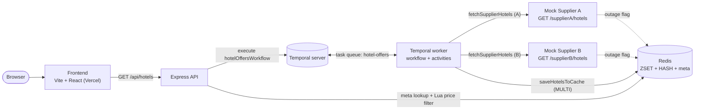
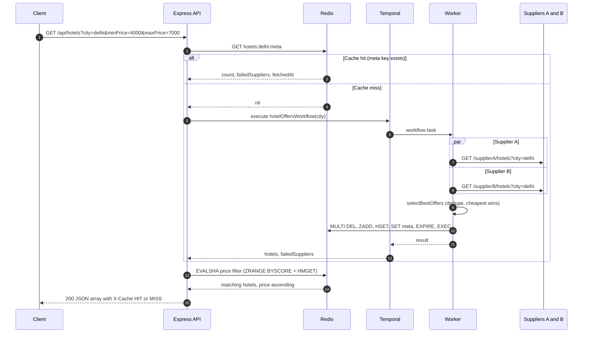

# Hotel Offer Orchestrator

[](https://github.com/project-devo/hotel-offer-orchestrator/actions/workflows/ci.yml)

A TypeScript service that asks two hotel suppliers for offers in a city, removes duplicate hotels, and returns the cheapest offer for each one. A **Temporal** workflow runs the comparison: both suppliers are called in parallel, with retries, and the result is still returned if one supplier fails. Every result is stored in **Redis**, and price-range filtering runs **inside Redis** with a Lua script. The stack is Express 5, Temporal, Redis and Docker Compose. It also includes a small React dashboard, a Postman collection and CI.

| | |
|---|---|
| **Frontend** | https://hotel-offer-orchestrator-one.vercel.app |
| **API example** | https://hotel-offer-orchestrator-api.onrender.com/api/hotels?city=delhi |
| **Health** | https://hotel-offer-orchestrator-api.onrender.com/health |

> The backend runs on Render's free tier and goes to sleep when idle. The first request after a pause can take about a minute while the container wakes up.

---

## Contents

1. [Architecture](#architecture)
2. [How Temporal is used](#how-temporal-is-used)
3. [How Redis is used](#how-redis-is-used)
4. [API reference](#api-reference)
5. [Data and de-duplication rules](#data-and-de-duplication-rules)
6. [Running locally](#running-locally)
7. [Configuration](#configuration)
8. [Deployment](#deployment)
9. [Design decisions and trade-offs](#design-decisions-and-trade-offs)
10. [Project structure](#project-structure)

---

## Architecture



The mock suppliers are routes in the same Express app, as the assignment requires. The worker reaches them over HTTP through `SUPPLIER_BASE_URL`, so the workflow treats them exactly like remote APIs.

The same image runs in three modes, selected with `APP_MODE`:

| Mode | Runs | Used by |
|---|---|---|
| `api` | HTTP server only | `api` container in Docker Compose |
| `worker` | Temporal worker only | `worker` container in Docker Compose |
| `all` | HTTP server first, then the worker | Render (single free container, plus an embedded Temporal dev server) |

### A filtered request, cache hit and cache miss



---

## How Temporal is used

**The workflow and activities are split.** `hotelOffersWorkflow` ([`workflows.ts`](backend/src/temporal/workflows.ts)) holds only deterministic orchestration. It imports `@temporalio/workflow`, the domain types and the pure `selectBestOffers` function, and nothing else. All I/O happens in activities ([`activities.ts`](backend/src/temporal/activities.ts)):

| Activity | Does | Timeout and retries |
|---|---|---|
| `fetchSupplierHotels({ supplier, city })` | `GET {SUPPLIER_BASE_URL}/supplier{A\|B}/hotels?city=…`, validated with zod | `startToCloseTimeout: 5s`; retry `300ms` initial, ×2 backoff, max `2s`, **3 attempts**; `SupplierBadResponse` is non-retryable |
| `saveHotelsToCache({ city, hotels, failedSuppliers })` | Atomic Redis write (see below) | `startToCloseTimeout: 5s`, 3 attempts |

**The suppliers are called in parallel.** The workflow starts both activities and waits for both with `Promise.allSettled`, so a slow supplier doesn't delay the other one, and a failure doesn't cancel it.

**The retry policy matches the error type.** A 5xx response, a timeout or a network error throws a plain `Error`, so Temporal retries it with backoff. A 4xx response or a malformed body is thrown as `ApplicationFailure.nonRetryable(…, 'SupplierBadResponse')`, because retrying a bad payload can't succeed. Activities log the start, the success (count and duration) and each failure (with the attempt number) through Temporal's activity logger. That logger is routed into pino, so all logs are structured JSON.

**Partial failure is handled.** After the retries are used up:
- **One supplier failed:** the workflow logs which supplier failed and why, continues with the other supplier's hotels and reports `failedSuppliers: ['B']`. The API returns `200` with an `X-Failed-Suppliers: B` header.
- **Both suppliers failed:** the workflow throws `ApplicationFailure.nonRetryable('All suppliers unavailable', 'AllSuppliersUnavailable')`. The API maps this to `503 SUPPLIERS_UNAVAILABLE`.

**Saving happens inside the workflow** as its last activity, so every successful run writes its result to Redis. The cache can't drift from what the workflow returned, the save gets Temporal's retries, and the API process never writes hotel data itself. A failed save fails the workflow, and the API returns `503 CACHE_UNAVAILABLE`.

**Other details:**
- **Client:** a lazily created singleton. Each request starts a run with id `hotel-offers-{city}-{uuid}` and a 30 s execution timeout. The id is returned in the `X-Workflow-Id` header and can be looked up in the Temporal UI.
- **Worker:** `maxCachedWorkflows: 50` and `maxConcurrentActivityTaskExecutions: 20`. In production the worker loads a **pre-built workflow bundle** (`npm run build:workflows` writes `dist/workflow-bundle.js`), so webpack never runs at startup on a 0.1 CPU instance. Dev and tests bundle from source.
- **Graceful shutdown:** on SIGTERM or SIGINT the process stops accepting HTTP, drains the worker, closes the Temporal client and Redis, then exits.

---

## How Redis is used

**Key model** (per normalized city):

| Key | Type | Content |
|---|---|---|
| `hotels:{city}:byPrice` | ZSET | score = price, member = normalized hotel name (e.g. `lotus grand`) |
| `hotels:{city}:data` | HASH | field = normalized name, value = the JSON response item `{ name, price, supplier, commissionPct }` |
| `hotels:{city}:meta` | STRING | JSON `{ count, failedSuppliers, fetchedAt }`; **its existence marks a cache hit** |

The meta key exists because a city with no hotels (`atlantis`) can't have a ZSET, since Redis deletes empty sorted sets. Without meta, an empty result could never be a cache hit. Meta also carries `failedSuppliers`, so a cached partial result still returns the `X-Failed-Suppliers` header.

**The write is atomic.** `saveHotelsToCache` runs a single `MULTI … EXEC`:
1. `DEL` all three keys.
2. `ZADD` and `HSET` (only if the list isn't empty).
3. `SET` meta.
4. `EXPIRE` all three keys.

Readers never see a half-written list.

**The price filter is one Lua script**, so it takes one round-trip and all filtering happens inside Redis. It's registered with ioredis `defineCommand`, which runs it with `EVALSHA`:

```lua
local names = redis.call('ZRANGE', KEYS[1], ARGV[1], ARGV[2], 'BYSCORE')
if #names == 0 then return {} end
return redis.call('HMGET', KEYS[2], unpack(names))
```

`ARGV[1]` is `minPrice` or `-inf`, and `ARGV[2]` is `maxPrice` or `+inf`. Both bounds are inclusive, and either can be omitted. Results come back ordered by price ascending; equal prices are ordered by name, because Redis orders equal scores by member. The script uses only Redis 6.2+ commands, so it works on Redis 7 locally and on Valkey (Render Key Value) in production.

**TTLs and cache semantics:**

| Situation | Behaviour |
|---|---|
| `GET /api/hotels?city=…` (no price params) | Always runs the workflow (a fresh comparison), which also refreshes the cache. `X-Cache: MISS` |
| Price params, `meta` exists | Lua filter only, no workflow. `X-Cache: HIT` |
| Price params, no `meta` | Runs the workflow (fills the cache), then the Lua filter. `X-Cache: MISS` |
| TTL, all suppliers OK | `CACHE_TTL_SECONDS` (600 s) |
| TTL, a supplier failed | `PARTIAL_CACHE_TTL_SECONDS` (60 s), so a degraded result is replaced quickly |

Simulated outages are stored as `supplier:status:A` / `supplier:status:B` = `down` with `EX SUPPLIER_DOWN_TTL_SECONDS` (300 s), so they recover on their own.

---

## API reference

Base URL: `http://localhost:3000` locally, or `https://hotel-offer-orchestrator-api.onrender.com` in production.

### `GET /api/hotels`

| Query param | Required | Rules |
|---|---|---|
| `city` | yes | 1–50 letters, spaces or hyphens; trimmed and lowercased |
| `minPrice` | no | number ≥ 0, inclusive |
| `maxPrice` | no | number ≥ 0, inclusive; must be ≥ `minPrice` when both are given |

```bash
curl -i "http://localhost:3000/api/hotels?city=delhi"
```
```http
HTTP/1.1 200 OK
X-Cache: MISS
X-Workflow-Id: hotel-offers-delhi-6cb8b565-f491-4a45-b917-d1dee4fd8dc7
X-Request-Id: 0b8f1c7e-…
```
```json
[
  { "name": "Courtyard Nine", "price": 2500, "supplier": "Supplier B", "commissionPct": 7 },
  { "name": "Banyan Stay", "price": 2900, "supplier": "Supplier A", "commissionPct": 9 },
  { "name": "Neem Tree Inn", "price": 3400, "supplier": "Supplier B", "commissionPct": 11 },
  { "name": "Holtin", "price": 5340, "supplier": "Supplier B", "commissionPct": 20 },
  { "name": "Radison", "price": 5900, "supplier": "Supplier A", "commissionPct": 13 },
  { "name": "Saffron Court", "price": 7600, "supplier": "Supplier A", "commissionPct": 14 },
  { "name": "Lotus Grand", "price": 8200, "supplier": "Supplier A", "commissionPct": 12 },
  { "name": "Peacock Plaza", "price": 9800, "supplier": "Supplier B", "commissionPct": 16 },
  { "name": "Marigold Suites", "price": 10950, "supplier": "Supplier B", "commissionPct": 11 }
]
```

```bash
curl -i "http://localhost:3000/api/hotels?city=delhi&minPrice=4000&maxPrice=7000"
# X-Cache: HIT
# [{"name":"Holtin","price":5340,"supplier":"Supplier B","commissionPct":20},
#  {"name":"Radison","price":5900,"supplier":"Supplier A","commissionPct":13}]

curl "http://localhost:3000/api/hotels?city=delhi&minPrice=9000"   # Peacock Plaza, Marigold Suites
curl "http://localhost:3000/api/hotels?city=delhi&maxPrice=3000"   # Courtyard Nine, Banyan Stay
curl "http://localhost:3000/api/hotels?city=atlantis"              # []
```

The response body is always exactly the array of `{ name, price, supplier, commissionPct }`. Everything else goes in headers:

| Header | When |
|---|---|
| `X-Cache` | `HIT` or `MISS`, always |
| `X-Workflow-Id` | whenever a workflow ran for this request |
| `X-Failed-Suppliers` | only when a supplier failed, e.g. `B` |
| `X-Request-Id` | always; echoes a valid incoming `X-Request-Id`, otherwise generated |

All of these are exposed through CORS.

### Errors

Every error uses the same shape:

```json
{ "error": { "code": "VALIDATION_ERROR", "message": "minPrice must be less than or equal to maxPrice", "details": [{ "field": "minPrice", "message": "minPrice must be less than or equal to maxPrice" }] } }
```

| Status | `code` | Cause |
|---|---|---|
| 400 | `VALIDATION_ERROR` | bad or missing query params |
| 404 | `NOT_FOUND` | unknown route |
| 503 | `SUPPLIERS_UNAVAILABLE` | both suppliers failed after retries |
| 503 | `TEMPORAL_UNAVAILABLE` | Temporal unreachable, or no worker finished the run within 30 s |
| 503 | `CACHE_UNAVAILABLE` | Redis unreachable |
| 500 | `INTERNAL_ERROR` | anything else (no internals or stack traces in production) |

### `GET /health` and `GET /health/live`

`/health` runs these checks in parallel, each with a 2 s timeout: both mock suppliers over HTTP, Redis `PING`, and a Temporal RPC.

```json
{
  "status": "degraded",
  "timestamp": "2026-11-22T10:00:00.000Z",
  "uptimeSeconds": 123,
  "suppliers": {
    "supplierA": { "status": "up", "latencyMs": 104 },
    "supplierB": { "status": "down", "latencyMs": 3, "error": "HTTP 503" }
  },
  "dependencies": { "redis": { "status": "up" }, "temporal": { "status": "up" } }
}
```

| `status` | Condition | HTTP |
|---|---|---|
| `ok` | everything up | 200 |
| `degraded` | exactly one supplier down | 200 |
| `down` | both suppliers down, or Redis down, or Temporal down | 503 |

`/health/live` always returns `200 {"status":"ok"}` while the process is running. Render uses it as the health check, so a dependency outage doesn't restart the container.

### Mock supplier APIs

`GET /supplierA/hotels` and `GET /supplierB/hotels` return the static data, optionally filtered by `?city=` (case-insensitive). Each response waits `SUPPLIER_LATENCY_MS` (100 ms) to feel like a remote call. If a simulated outage is active, the endpoint returns `503 { "error": { "code": "SUPPLIER_DOWN", … } }`.

```json
[ { "hotelId": "a1", "name": "Holtin", "price": 6000, "city": "delhi", "commissionPct": 10 } ]
```

### Outage simulator (demo admin endpoints)

```bash
curl -X POST http://localhost:3000/admin/suppliers/B/down   # {"supplier":"B","status":"down","autoRecoverSeconds":300}
curl -X POST http://localhost:3000/admin/suppliers/B/up     # {"supplier":"B","status":"up"}
curl http://localhost:3000/admin/suppliers                  # {"suppliers":{"A":{"status":"up","ttlSeconds":null},"B":{...}}}
```

`:supplier` accepts `A`, `B`, `supplierA` or `supplierB`, case-insensitive. These endpoints are **unauthenticated by design** so that reviewers can try the failure paths. A `down` flag **expires automatically after 5 minutes** (`SUPPLIER_DOWN_TTL_SECONDS`), so the public demo can't be left broken.

---

## Data and de-duplication rules

The mock data lives in [`backend/src/data`](backend/src/data). It covers three cities with overlapping hotel names:
- **delhi:** 7 hotels per supplier, 5 overlapping
- **mumbai:** 6 per supplier, 3 overlapping, with at least one won by each supplier
- **bangalore:** 5 per supplier, 2 overlapping

Every other city returns `[]` from both suppliers.

[`selectBestOffers`](backend/src/domain/selectBestOffers.ts) is a pure, deterministic function, and the workflow calls it directly:

1. **Matching key:** trim the name, collapse internal whitespace, lowercase. Supplier B lists `"lotus grand "` (lowercase, trailing space) on purpose, and it still matches Supplier A's `"Lotus Grand"`.
2. **Winner:** lowest price. On a price tie, the **higher `commissionPct`** wins. On a full tie, **Supplier A** wins.
3. **Output name:** the winning offer's name, trimmed and with whitespace collapsed.
4. **Sort:** price ascending, then name.

Expected Delhi result (9 hotels):

| name | price | supplier | commissionPct | why |
|---|---|---|---|---|
| Courtyard Nine | 2500 | Supplier B | 7 | B only |
| Banyan Stay | 2900 | Supplier A | 9 | A only |
| Neem Tree Inn | 3400 | Supplier B | 11 | price tie, higher commission wins |
| Holtin | 5340 | Supplier B | 20 | B cheaper |
| Radison | 5900 | Supplier A | 13 | A cheaper |
| Saffron Court | 7600 | Supplier A | 14 | A only |
| Lotus Grand | 8200 | Supplier A | 12 | matched despite case/space difference; A cheaper |
| Peacock Plaza | 9800 | Supplier B | 16 | B only |
| Marigold Suites | 10950 | Supplier B | 11 | B cheaper |

---

## Running locally

**Prerequisites:** Docker Desktop (or Docker Engine) with Compose v2, plus Node.js 22 and npm for the frontend, tests and Postman.

```bash
docker compose up -d --build
```

| Service | URL |
|---|---|
| API | http://localhost:3000 (e.g. http://localhost:3000/api/hotels?city=delhi) |
| Temporal Web UI | http://localhost:8233 (every request shows up as a `hotelOffersWorkflow` run) |
| Frontend (dev server, below) | http://localhost:5173 |

Compose runs four containers: `redis`, `temporal` (the official `temporalio/temporal` CLI image running the dev server), `api` and `worker`. The last two use the same backend image with a different `APP_MODE`. Startup order is enforced with health checks.

> If port 3000 is already in use, set another host port: `API_PORT=3001 docker compose up -d --build`.

**Frontend:**

```bash
cd frontend && npm i && npm run dev
# points at http://localhost:3000 by default; override with VITE_API_URL=http://localhost:3001
```

**Tests:**

```bash
cd backend && npm ci
npm run typecheck
npm test                    # unit + workflow tests (downloads a Temporal test server on first run)
docker compose up -d redis  # integration tests need Redis; they skip with a message if it's unreachable
npm run test:integration    # Redis store + Lua filter, API routes via supertest
npm run test:all            # everything
```

**End-to-end with Postman/newman** (against the running Compose stack):

```bash
npx --yes newman run postman/hotel-offer-orchestrator.postman_collection.json -e postman/local.postman_environment.json
```

The 18 requests cover the overlap city, all price-filter variants, the no-results city, validation errors, one supplier down (partial result) and both suppliers down (503). The collection restores both suppliers at the end. To use the Postman app instead, import the collection and an environment from [`postman/`](postman).

---

## Configuration

All backend settings are environment variables, validated with zod at startup ([`config.ts`](backend/src/config.ts)). See [`backend/.env.example`](backend/.env.example).

| Variable | Default | Notes |
|---|---|---|
| `NODE_ENV` | `development` | `production` disables pretty logs and hides error internals |
| `PORT` | `3000` | Render injects its own |
| `APP_MODE` | `all` | `api`, `worker` or `all` |
| `LOG_LEVEL` | `info` | pino level |
| `REDIS_URL` | `redis://localhost:6379` | |
| `TEMPORAL_ADDRESS` | `localhost:7233` | |
| `TEMPORAL_NAMESPACE` | `default` | |
| `TEMPORAL_API_KEY` | unset | when set: TLS + API key (Temporal Cloud) |
| `TEMPORAL_TASK_QUEUE` | `hotel-offers` | |
| `EMBEDDED_TEMPORAL` | `false` | `true`: the entrypoint starts a Temporal dev server in the container |
| `SUPPLIER_BASE_URL` | `http://127.0.0.1:${PORT}` | where activities and `/health` reach the mock suppliers |
| `SUPPLIER_TIMEOUT_MS` | `3000` | per supplier request |
| `SUPPLIER_LATENCY_MS` | `100` | artificial latency in the mock endpoints |
| `CACHE_TTL_SECONDS` | `600` | full result |
| `PARTIAL_CACHE_TTL_SECONDS` | `60` | when a supplier failed |
| `SUPPLIER_DOWN_TTL_SECONDS` | `300` | simulated outages recover on their own |
| `CORS_ORIGINS` | `http://localhost:5173` | comma-separated; `https://hotel-offer-orchestrator*.vercel.app` is always allowed |

Frontend: `VITE_API_URL` (default `http://localhost:3000`). It's baked in at build time.

---

## Deployment

### Backend: Render (free web service + free Key Value)

[`render.yaml`](render.yaml) is the blueprint for the deployment. It's validated against Render's published schema.

- **`hotel-offer-orchestrator-api`:** a free Docker web service in Singapore, built from `./backend/Dockerfile`, with health check `/health/live`. Render's free tier has no background workers or private services, so **one container runs everything**:
  1. `docker-entrypoint.sh` starts `temporal server start-dev --headless` on `127.0.0.1:7233` (`EMBEDDED_TEMPORAL=true`).
  2. It waits until `temporal operator cluster health` passes.
  3. It starts Node with `APP_MODE=all`: the HTTP server first, then the worker.
  4. On SIGTERM, Node shuts down gracefully, then the dev server stops.
- **`hotel-offers-redis`:** free Key Value (Valkey) in Singapore. The web service gets its internal connection string as `REDIS_URL`.

Web service environment: `NODE_ENV=production`, `APP_MODE=all`, `EMBEDDED_TEMPORAL=true`, `TEMPORAL_ADDRESS=127.0.0.1:7233`, `TEMPORAL_NAMESPACE=default`, `LOG_LEVEL=info`, `REDIS_URL=<internal Key Value URL>`. `PORT` is injected by Render, and `SUPPLIER_BASE_URL` defaults to `http://127.0.0.1:$PORT`.

To reproduce: in Render, choose **New → Blueprint**, select this repository, and apply. Or create the two resources by hand with the values above. Pushes to `main` redeploy automatically.

The image was tested under the free-tier limits (`docker run --memory=512m --cpus=0.1`). It was healthy in about 40 s, passed the full Postman run, and peaked around 210 MB.

### Frontend: Vercel

A Vercel project linked to this repository, with **Root Directory `frontend`** and the Vite framework preset. Set **`VITE_API_URL`** to the Render URL for Production and Preview. It's read at build time, so redeploy after changing it. The backend allows `https://hotel-offer-orchestrator*.vercel.app` (production and preview URLs) through CORS.

```bash
cd frontend
vercel link            # create or link the project (root directory: frontend)
vercel env add VITE_API_URL production
vercel deploy --prod
```

### Switching to Temporal Cloud

No code changes are needed. Set three variables on the service and turn off the embedded server:

```bash
TEMPORAL_ADDRESS=<region>.<cloud>.api.temporal.io:7233   # your namespace's endpoint
TEMPORAL_NAMESPACE=<namespace>.<account-id>
TEMPORAL_API_KEY=<api key>                               # enables TLS + API-key auth
EMBEDDED_TEMPORAL=false
```

---

## Design decisions and trade-offs

- **The embedded Temporal dev server is a free-tier compromise.** It runs with in-memory persistence inside the API container, so workflow history is lost on every restart, and there's no high availability. It's enough to show real Temporal orchestration (parallel activities, retries, failure handling, visible run history) at zero cost. In production it would be replaced with Temporal Cloud (three env vars, above) or a self-hosted cluster.
- **Free-tier cold starts.** Render stops idle free services. The first request after a pause waits for the container to boot and the Temporal dev server to become ready, which takes about a minute. The frontend shows a "waking up" banner during that time, and the Postman production run uses a 120 s request timeout.
- **The free Key Value store is in memory only.** That's fine here, because everything in Redis is a cache with a TTL that a workflow run can rebuild.
- **Unfiltered requests always run the workflow.** That keeps `GET /api/hotels?city=…` a live comparison, as the assignment describes. Only filtered requests are served from the cache.
- **The admin outage toggle is unauthenticated, with auto-expiry.** It's a deliberate demo feature, kept safe by the 5-minute TTL. A toggle doesn't invalidate cached results, so a filtered request can return a cache hit from before the outage until the next unfiltered request or the TTL refreshes it.
- **Mock suppliers live in the same service**, as the assignment specifies. They're still called over HTTP, so timeouts, retries and outages behave like they would with real suppliers.
- **The response body is exactly the specified array.** Cache status, workflow id and failed suppliers travel in headers.
- **What I'd change for production:**
  - Temporal Cloud or a self-hosted cluster, with the worker as a separately scaled service.
  - Authentication on the admin routes, or remove them.
  - Rate limiting.
  - Metrics and tracing (OpenTelemetry via the Temporal SDK interceptors, plus Prometheus).
  - Real supplier clients with circuit breakers and per-supplier timeouts.
  - Request coalescing, so concurrent cache misses for the same city share one workflow run.
  - A persistent Redis with a paid plan.

---

## Project structure

```
hotel-offer-orchestrator/
├── backend/
│   ├── src/
│   │   ├── index.ts                  # entry point; APP_MODE = api | worker | all; graceful shutdown
│   │   ├── config.ts                 # env parsing + validation (zod)
│   │   ├── logger.ts                 # pino (pretty in development)
│   │   ├── domain/
│   │   │   ├── types.ts
│   │   │   ├── schemas.ts            # zod schema for supplier payloads
│   │   │   └── selectBestOffers.ts   # pure dedupe/selection logic
│   │   ├── data/                     # supplierA.json, supplierB.json
│   │   ├── temporal/
│   │   │   ├── workflows.ts          # hotelOffersWorkflow
│   │   │   ├── activities.ts         # fetchSupplierHotels, saveHotelsToCache
│   │   │   ├── worker.ts             # NativeConnection + Worker (pre-built bundle in prod)
│   │   │   ├── client.ts             # client singleton + error mapping
│   │   │   ├── connection.ts         # local vs Temporal Cloud options
│   │   │   └── bundle.ts             # build-time workflow bundling
│   │   ├── redis/
│   │   │   ├── client.ts
│   │   │   ├── hotelStore.ts         # MULTI write + Lua price filter
│   │   │   └── supplierStatus.ts     # simulated outage flags
│   │   └── api/
│   │       ├── app.ts                # createApp(deps): CORS, logging, routes, errors
│   │       ├── server.ts
│   │       ├── validation.ts
│   │       ├── errors.ts
│   │       └── routes/               # hotels.ts, suppliers.ts, health.ts, admin.ts
│   ├── test/
│   │   ├── unit/                     # selectBestOffers, validation, data integrity
│   │   ├── workflow/                 # TestWorkflowEnvironment with mocked activities
│   │   └── integration/              # real Redis: store + API via supertest
│   ├── Dockerfile                    # multi-stage, Debian slim, non-root, Temporal CLI included
│   ├── docker-entrypoint.sh          # optional embedded Temporal dev server
│   └── .env.example
├── frontend/                         # Vite + React + TypeScript + Tailwind dashboard
├── postman/                          # collection + local/production environments
├── .github/workflows/ci.yml          # backend, frontend and Docker jobs
├── docker-compose.yml                # redis, temporal, api, worker
├── render.yaml                       # Render blueprint
└── README.md
```
